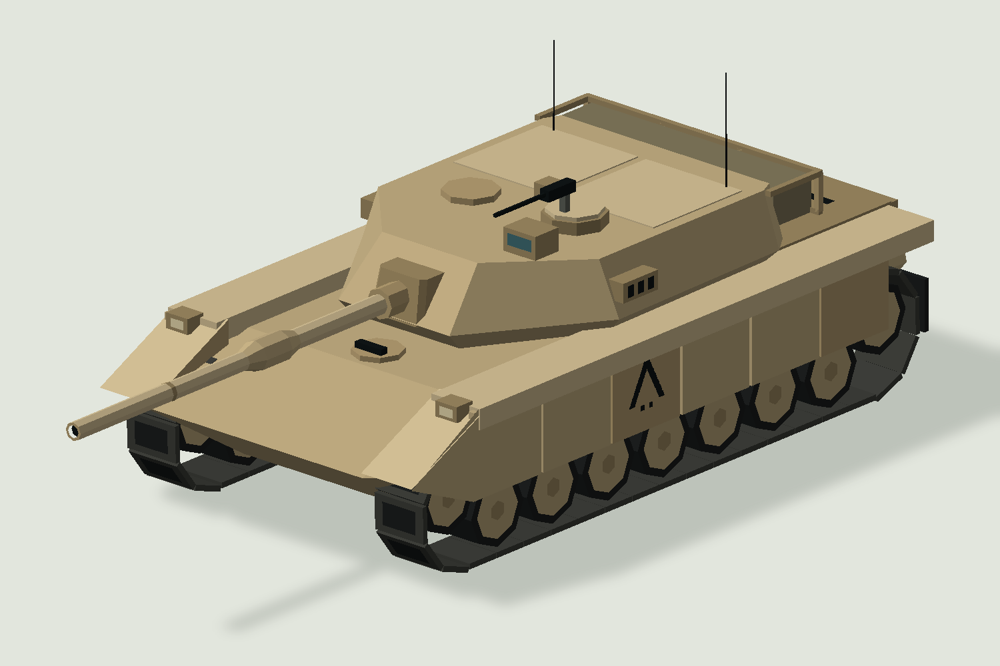
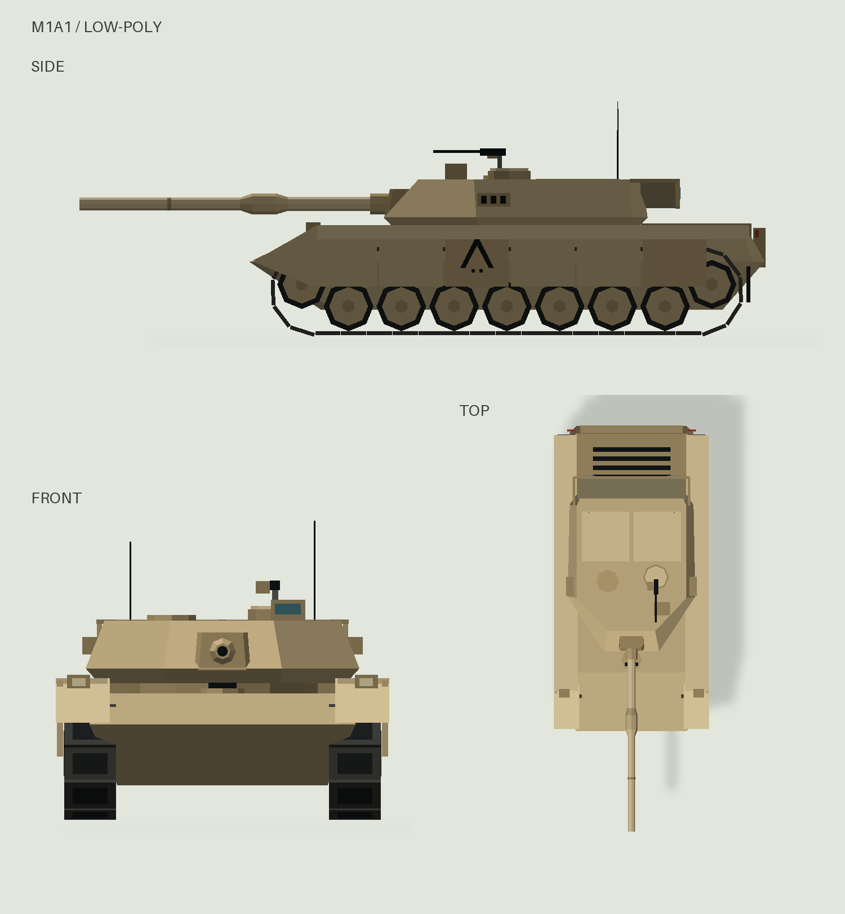
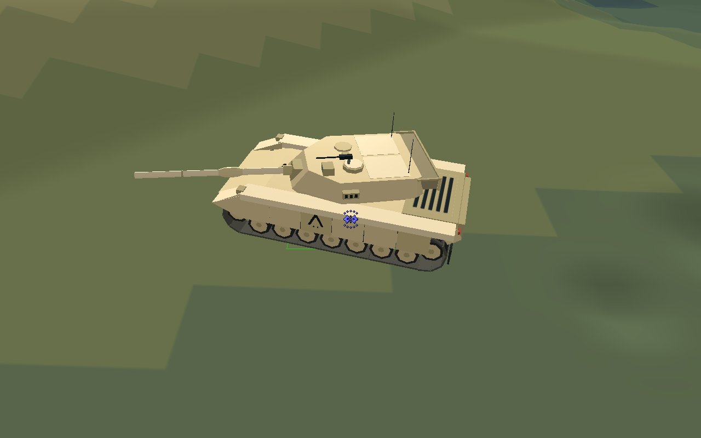

# M1A1 v1 风格基准档案

建立日期：**2026-11-09**。本档案记录这次 M1A1 的已存在资产、实现方式及可复用的美术特征，为[通用指南](../UNIT_MODELING_STYLE.md)提供实物依据。

用户要求将这次 M1A1 的整体建模风格作为以后机械与生物单位的标准；这不等于用户逐项指定过下文的每个技术数字。机械与生物适配规则是从本案例提炼和扩展的规范。

## 1. 固定视觉参考

以下三个副本建立指南时直接复制自原预览目录，未进行调色或重绘。它们与生成器输出分离，后续重新生成 M1A1 不会自动替换本基准。

### 前侧：观察大体积、分面与色块



这是**离线渲染**。观察低矮车体、楔形炮塔、长炮管、侧裙的大色面、深色轮履，以及只占少量面积的观察窗和标记。

### 三视图：观察比例与结构节奏



这是**离线多视图**。侧面读长宽高层级与七对负重轮，正面读炮塔斜面和车体宽度，顶面读长尾舱、后部格栅和设备布局。不要仅依赖前侧透视判断比例。

### 游戏内：观察真实光照和占屏效果



这是项目**已有的实机截图**，不是编写指南时新启动引擎获得的截图。它用于对照引擎光照下的色块与细节密度，不能单凭一张静态图证明所有动画通过。

## 2. 风格观察与迁移

| M1A1 的具体表现 | 通用化的原则 | 迁移边界 |
| --- | --- | --- |
| 低矮车体、楔形炮塔、长尾舱 | 先保留对象最有辨识度的主形体 | 生物应换成头颈、胸腹、肩背与骨盆等自己的形体 |
| 轮、炮管和舱盖有可见分面 | 用少量面表达清楚的截面和体积 | 生物分面沿解剖，不固定为八边形肢体 |
| 大块沙色与少量明暗变体 | 主体统一、颜色职责清楚 | 沙色只是该坦克的涂装 |
| 深色轮履、小观察窗、大战术符号 | 用有限对比区解释结构并建立焦点 | 其他单位换成自己的关节、口鼻、眼、材质和标记 |
| 通风槽由简单贴图表达 | 不影响轮廓的浅层信息尽量压缩 | 会影响识别或运动的附肢仍需要真实几何 |
| 车顶设备与储物篮高度简化 | 保留功能提示，去掉微小重复件 | 不是删掉所有二级形体 |
| 轮履、炮塔、炮管有相应分件 | 几何结构服务于需要的运动 | 不要求所有单位使用坦克节点树 |

源码说明以多视图确定 M1A1 轮廓，以另一张低模参考确定细节密度；参见[生成器开头](../../tools/build_m1a1.py#L1-L10)和[原测试说明](../M1A1_TESTING.md#L17-L35)。原始参考图片未打包到本档案，不声称这里重新完成了对原图的比例鉴定。

## 3. 当前案例数据

数值来自当前[manifest](../../tools/previews/m1a1_manifest.json)、[生成源](../../tools/build_m1a1.py#L26-L41)及[资产测试](../../tools/test_m1a1.py)。它们记录基准，不是所有新单位的配额。

| 项目 | M1A1 v1 |
| --- | --- |
| 风格字段 | `flat-shaded low-poly` |
| 最终三角面 | **3,058**，按所有可见 piece 实例合计 |
| 生成器上限 | **3,200** |
| 节点 | **102**：车体、炮塔、炮管、空炮口定位节点、14 负重轮、4 端轮、80 履带节 |
| 轮履节奏 | 每侧 7 个负重轮、2 个端轮、40 个履带节 |
| 原生贴图 | 两张 **256 × 256** RGBA TGA |
| 图标 | **256 × 256** RGBA PNG |
| 项目坐标 | X 向右、Y 向上、Z 向前 |
| 静止整体边界最小值 | `(-21.9, 0.1808368, -43.16)` |
| 静止整体边界最大值 | `(21.9, 39.4, 71.3)` |
| 运行模型 | [m1a1.s3o](../../Objects3d/m1a1.s3o) |
| 交换模型 | [m1a1.glb](../../Objects3d/m1a1.glb) |

边界包含炮管和天线，不代表车体本身的长宽高，更不是现实米制尺寸。模型是游戏用的简化外形，不是工程级比例复刻。机枪和烟幕装置在当前版本是装饰，不能因有几何就宣称对应功能已经实现。

## 4. 实际调色板

来源：[COLORS](../../tools/build_m1a1.py#L29-L37)。这是 14 个语义色；亮暗材质色块与渲染后的像素颜色不同，截图会受光照影响。

| 名称 | RGB | HEX | 主要职责 |
| --- | --- | --- | --- |
| sand | 198, 177, 133 | #C6B185 | 主体沙色 |
| sand_light | 216, 196, 153 | #D8C499 | 较浅的主结构和局部面 |
| sand_dark | 160, 140, 100 | #A08C64 | 较深的结构区 |
| sand_edge | 184, 161, 116 | #B8A174 | 局部结构变体 |
| rubber | 30, 33, 33 | #1E2121 | 轮胎、履带衬块等深色区 |
| track | 63, 64, 59 | #3F403B | 履带主体 |
| hub | 190, 170, 126 | #BEAA7E | 轮面 |
| black | 17, 23, 24 | #111718 | 孔口、格栅和标记等 |
| glass | 64, 108, 115 | #406C73 | 观察窗 |
| steel | 92, 96, 88 | #5C6058 | 少量设备结构 |
| lamp | 229, 216, 173 | #E5D8AD | 灯的浅色表面 |
| red | 153, 59, 42 | #993B2A | 尾灯点缀 |
| team | 68, 133, 185 | #4485B9 | 队色区域的基础显示色 |
| canvas | 132, 123, 94 | #847B5E | 储物／帆布区 |

迁移到新单位时保留“主体、结构暗色、材质色、少量焦点、队色”的职责关系，不要求保留这些 RGB 或正好 14 色。原生纹理 A 通道的不同语义见[技术分支](RECOIL_PIPELINE.md#4-贴图与材质通道)。

## 5. 已验证实现与不可直接推广之处

- [圆柱封装](../../tools/build_m1a1.py#L55-L58)默认 8 边且 `smooth=False`；炮塔环等局部有不同边数。
- [基础面生成](../../tools/build_ztz99a.py#L154-L170)为一个多边形面提供一致法线，三角化不等于随机制造亮暗三角块。
- [主体 UV](../../tools/build_m1a1.py#L44-L52)多取纯色色块中心；战术标记与格栅使用专门的图集矩形。
- [炮塔](../../tools/build_m1a1.py#L136-L180)通过多层轮廓与有限设备形成，而非一个普通方盒。高度缩放同时修正法线。
- [运动脚本](../../Scripts/m1a1script.lua)驱动炮塔、俯仰、后坐与履带控制器，不叠加周期车体弹跳；这不是禁止生物呼吸或步态起伏。
- GLB 是静态分件交换资产，不包含当前游戏 Lua 动画，也不提供已验证的生物蒙皮链路。
- 99A 提供了可复用基础图元、导出与渲染代码，但它自身更高的面数与迷彩图集不是本次选定的风格基准。

## 6. 验证记录

2026-11-09 编写指南时，从工作区根目录执行：

```sh
python -I -B games/MyGame.sdd/tools/test_m1a1.py
```

结果：**12 项测试通过**。该次检查核对已有资产与生成源，不重建模型、不重新渲染、不启动引擎。

历史交付提及的其他自动检查和实机场景不计入本次结果。本指南固定的实机图片是已有证据；本次没有重跑履带 Lua 测试或引擎 smoke 测试。

## 7. 图片来源与校验

| 固定副本 | 复制来源 |
| --- | --- |
| [m1a1-v1-front.png](reference/m1a1-v1-front.png) | [当前前侧预览](../../tools/previews/m1a1_front.png) |
| [m1a1-v1-views.png](reference/m1a1-v1-views.png) | [当前多视图](../../tools/previews/m1a1_views.png) |
| [m1a1-v1-ingame.png](reference/m1a1-v1-ingame.png) | [已有实机截图](../../tools/previews/m1a1_ingame.png) |

建立副本时确认内容逐字节一致，SHA-256 为：

```text
m1a1-v1-front.png  b9e3b22cd50d1803aaa3ea8eecf9c911c34c80e5baf6cb948c3d9bef4c6d1050
m1a1-v1-views.png  a25df37a6d007b558a40ad76ed4a70d0e08021e5f5db1e18907abbfe20f66df6
m1a1-v1-ingame.png 7490d8a353fd4d507cf471d5e45abdc58f1f29e48819926a5b92e663ba12b90c
```

固定图是 v1 视觉基准，源资产链接用于定位实现，二者可能在未来的新版本中分离。需要升级风格时建立新的基准档案，不悄悄用新渲染覆盖这里的旧图。
